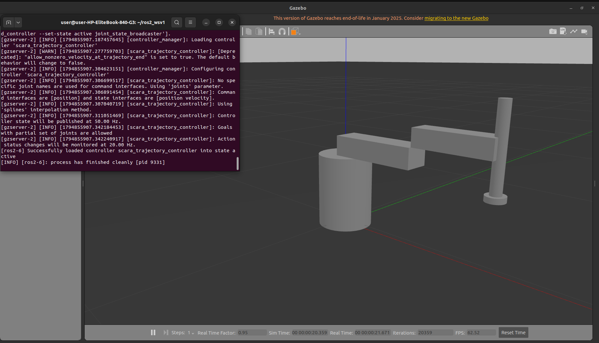
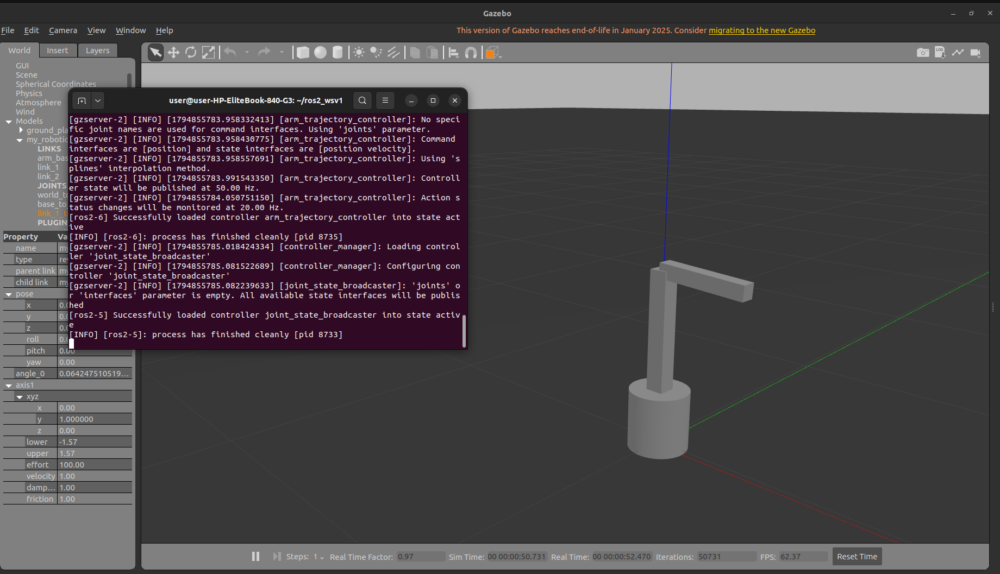

# ROS 2 Robotic Arms — Simulation & Trajectory Control

A ROS 2 Humble workspace for learning robot modelling, simulation and control. It contains URDF/Xacro robot descriptions, Gazebo simulation launch files and `ros2_control` configurations for two robotic arms, both driven by the **Joint Trajectory Controller** (spline-interpolated motion from position / velocity / acceleration waypoints).

| Package | Description |
|---|---|
| [`my_robot_description`](my_robot_description/) | 2-DOF planar robotic arm — Gazebo + RViz, `arm_trajectory_controller` |
| [`scara_robot_description`](scara_robot_description/) | 4-DOF ABB-style SCARA robot (RRPR) — Gazebo, `scara_trajectory_controller` |
| [`my_robot_interfaces`](my_robot_interfaces/) | Custom messages, services and actions |
| [`my_project`](my_project/) | Python nodes used while learning ROS 2 basics |

---

## Robots

<table>
  <tr>
    <th>ABB SCARA Robot (4-DOF)</th>
    <th>2-DOF Robotic Arm</th>
  </tr>
  <tr>
    <td></td>
    <td></td>
  </tr>
</table>

---

## Demonstrations

### ABB SCARA Robot (4-DOF)

<video src="videos/Abb_Scara_robot.webm" controls width="720"></video>

▶️ [Watch the ABB SCARA robot demo](videos/Abb_Scara_robot.webm)

### 2-DOF Robotic Arm — Joint Trajectory Controller

<video src="videos/Robotic-arm-trajeectory-controleller.webm" controls width="720"></video>

▶️ [Watch the 2-DOF robotic arm demo](videos/Robotic-arm-trajeectory-controleller.webm)

---

## Prerequisites

- Ubuntu 22.04
- [ROS 2 Humble](https://docs.ros.org/en/humble/Installation.html) (desktop install)
- Gazebo Classic 11

## Installation

### 1. Install dependencies

```bash
sudo apt update
sudo apt install -y \
  python3-colcon-common-extensions \
  ros-humble-xacro \
  ros-humble-robot-state-publisher \
  ros-humble-joint-state-publisher-gui \
  ros-humble-rviz2 \
  ros-humble-gazebo-ros-pkgs \
  ros-humble-ros2-control \
  ros-humble-ros2-controllers \
  ros-humble-gazebo-ros2-control
```

### 2. Clone the repository into a workspace

```bash
mkdir -p ~/ros2_wsv1
cd ~/ros2_wsv1
git clone https://github.com/Ahmad1pointO/ros2_wsv1-src.git src
```

### 3. Build the workspace

```bash
cd ~/ros2_wsv1
source /opt/ros/humble/setup.bash
colcon build
source install/setup.bash
```

> **Tip:** add `source ~/ros2_wsv1/install/setup.bash` to your `~/.bashrc` so every new terminal is ready to use.

---

## Usage

Each command below needs a sourced terminal (`source ~/ros2_wsv1/install/setup.bash`).

### 2-DOF Robotic Arm (`my_robot_description`)

**Terminal 1 — launch the simulation:**

```bash
ros2 launch my_robot_description arm_display.launch.py
```

**Terminal 2 — send a trajectory goal:**

```bash
ros2 action send_goal /arm_trajectory_controller/follow_joint_trajectory control_msgs/action/FollowJointTrajectory "{
  trajectory: {
    joint_names: ['base_to_link_1_joint', 'link_1_to_link_2_joint'],
    points: [
      { positions: [1.0, -0.5], velocities: [0.0, 0.0], time_from_start: { sec: 3, nanosec: 0 } },
      { positions: [0.0, 0.0],  velocities: [0.0, 0.0], time_from_start: { sec: 6, nanosec: 0 } }
    ]
  }
}" --feedback
```

📄 Full command reference, including the position + velocity + acceleration variant: [`my_robot_description/Commands-used.md`](my_robot_description/Commands-used.md)

### ABB SCARA Robot (`scara_robot_description`)

**Terminal 1 — launch the simulation:**

```bash
ros2 launch scara_robot_description scara_gazebo.launch.py
```

**Terminal 2 — send a pick-style trajectory goal:**

```bash
ros2 action send_goal /scara_trajectory_controller/follow_joint_trajectory control_msgs/action/FollowJointTrajectory "{
  trajectory: {
    joint_names: ['joint_1', 'joint_2', 'joint_3', 'joint_4'],
    points: [
      { positions: [0.8, -1.2, 0.0, 1.57],   velocities: [0.0, 0.0, 0.0, 0.0], accelerations: [0.0, 0.0, 0.0, 0.0], time_from_start: { sec: 3, nanosec: 0 } },
      { positions: [0.8, -1.2, -0.12, 1.57], velocities: [0.0, 0.0, 0.0, 0.0], accelerations: [0.0, 0.0, 0.0, 0.0], time_from_start: { sec: 5, nanosec: 0 } },
      { positions: [0.0, 0.0, 0.0, 0.0],     velocities: [0.0, 0.0, 0.0, 0.0], accelerations: [0.0, 0.0, 0.0, 0.0], time_from_start: { sec: 8, nanosec: 0 } }
    ]
  }
}" --feedback
```

📄 Full command reference, including how the package was created: [`scara_robot_description/Commands _used_in_scara_pkg.md`](scara_robot_description/Commands%20_used_in_scara_pkg.md)

---

## How trajectory interpolation works

The `JointTrajectoryController` builds a spline between waypoints based on the fields you provide:

| Fields given per waypoint | Spline used |
|---|---|
| positions only | Linear |
| positions + velocities | Cubic (3rd-degree polynomial) |
| positions + velocities + accelerations | Quintic (5th-degree polynomial) |

Quintic splines give smooth position, velocity and acceleration profiles, which is why the SCARA example specifies all three.

---

## Repository Structure

```
src/
├── my_robot_description/       # 2-DOF arm: urdf/, config/, launch/
├── scara_robot_description/    # SCARA robot: urdf/, config/, launch/
├── my_robot_interfaces/        # Custom msg / srv / action definitions
├── my_project/                 # Python learning nodes
└── videos/                     # Demo recordings and screenshots
```

## License

Released under the [MIT License](LICENSE).
