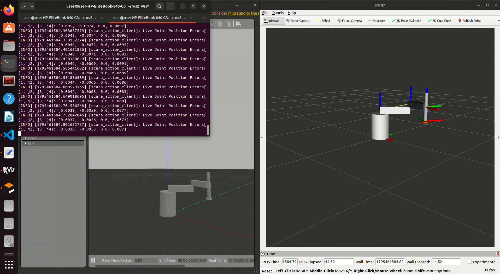

# scara_control

A ROS 2 Humble Python package that commands the 4-DOF ABB-style SCARA robot from [`scara_robot_description`](../scara_robot_description/).

Its `pick_and_place` node is an action client for the robot's Joint Trajectory Controller. Instead of typing a long `ros2 action send_goal` command by hand, you run one node and it performs a complete pick cycle from predefined joint angles.



▶️ [Watch the demo video](../videos/ABB_Scara_in_action_with_predefined_path.webm). If it does not open, click "view raw".

---

## How it works with `scara_robot_description`

This package does not start the robot. It needs the simulation from `scara_robot_description` to be running first.

| Package | Role |
|---|---|
| `scara_robot_description` | Robot model (URDF/Xacro), Gazebo + RViz launch, and `ros2_control` controllers. It provides the action server `/scara_trajectory_controller/follow_joint_trajectory`. |
| `scara_control` | The `pick_and_place` node. It connects to that action server and sends the trajectory goal. |

```
pick_and_place (action client)
        │  FollowJointTrajectory goal
        ▼
/scara_trajectory_controller (JointTrajectoryController)
        │  position commands, 100 Hz
        ▼
gazebo_ros2_control ──► SCARA robot in Gazebo
```

---

## Dependencies

- `rclpy`
- `control_msgs`
- `trajectory_msgs`
- `builtin_interfaces`

You also need the `scara_robot_description` package in the same workspace. See the [main README](../README.md#installation) for the full install steps.

---

## How to run

Both packages need to be in `~/ros2_wsv1/src`.

**Terminal 1: build and launch the SCARA simulation (Gazebo + RViz)**

```bash
cd ~/ros2_wsv1
colcon build
source install/setup.bash
ros2 launch scara_robot_description scara_gazebo.launch.py
```

Wait until Gazebo shows the robot and the terminal shows that both `joint_state_broadcaster` and `scara_trajectory_controller` are active.

**Terminal 2: run the pick cycle**

```bash
cd ~/ros2_wsv1
colcon build
source install/setup.bash
ros2 run scara_control pick_and_place
```

To build only this package, run `colcon build --packages-select scara_control`.

---

## The pick cycle

The node sends one goal containing three waypoints. Each waypoint includes positions, velocities and accelerations, so the controller follows a smooth quintic spline between them.

| Waypoint | Time | Joint positions `[j1, j2, j3, j4]` | Motion |
|---|---|---|---|
| 1 | 3 s | `[0.8, -1.2, 0.0, 1.57]` | Swing over the pick station |
| 2 | 5 s | `[0.8, -1.2, -0.12, 1.57]` | Lower the quill 12 cm to the part |
| 3 | 8 s | `[0.0, 0.0, 0.0, 0.0]` | Retract and return home |

Units: `joint_1`, `joint_2` and `joint_4` are in radians, and `joint_3` (the prismatic quill) is in metres.

### Expected output

```
Waiting For the scara_trajectory_cntroller action server....
Sending 3-waypoint quintic pick-and-place trajectory...
Trajectory Goal Accepted by Controller!, Executing Trajectory spline...
Live Joint Position Errors[j1, j2, j3, j4]: [...]
Trajectory Execution Complete: SUCCESS, Pick and Place cycle complete!
```

After the result, the node shuts down. Run it again to repeat the cycle.

### Changing the motion

Edit the waypoints in `send_pick_and_place_goal()` in [`scara_control/pick_and_place_client.py`](scara_control/pick_and_place_client.py), then rebuild. Keep each joint inside its limits from the URDF:

| Joint | Type | Limits |
|---|---|---|
| `joint_1` | Revolute (shoulder) | −2.44 to 2.44 rad |
| `joint_2` | Revolute (elbow) | −2.61 to 2.61 rad |
| `joint_3` | Prismatic (quill) | −0.15 to 0.0 m |
| `joint_4` | Revolute (wrist roll) | −6.28 to 6.28 rad |

---

## Troubleshooting

| Problem | Likely cause |
|---|---|
| Node stays at "Waiting For the ... action server" | The simulation is not running, or the controllers have not loaded yet. Check with `ros2 control list_controllers`. |
| `Package 'scara_control' not found` | The terminal is not sourced. Run `source install/setup.bash` from `~/ros2_wsv1`. |
| "Trajectory Goal was Rejected by Controller!" | A joint name is misspelled, or a position is outside the joint limits. |

---

## Current limitations and next steps

- **Predefined joint angles:** there is no inverse kinematics yet. The next step is to give the robot X, Y, Z and yaw coordinates and calculate the joint angles.
- **One cycle per run:** the node does not loop yet.
- **No place step:** there is no place station or gripper yet.
